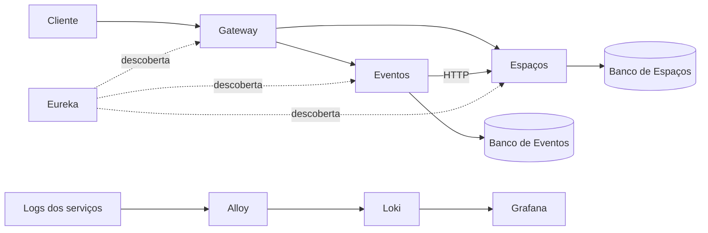

# IndieStage

Sistema de eventos culturais desenvolvido para o Projeto de Bloco de Engenharia de Softwares Escaláveis do Instituto Infnet.

O projeto tem dois serviços de negócio: **Eventos**, responsável pelos eventos, e **Espaços**, responsável pelos locais onde eles acontecem. Cada um tem sua própria aplicação e seu próprio banco. Para apresentar os detalhes de um evento, Eventos consulta a API de Espaços.

## Arquitetura



O Gateway recebe as chamadas externas e encaminha para o serviço correspondente. O Eureka mantém o registro das instâncias, usado para localizar os serviços pelo nome. As chamadas de negócio não passam pelo Eureka.

Eventos guarda o `espacoId` e busca os dados do local por HTTP, usando RestClient com LoadBalancer. Não acessa o banco de Espaços. As rotas do Gateway usam `lb://eventos` e `lb://espacos`.

Tecnologias: Java 21, Spring Boot 4.0.9, Spring Cloud 2025.1.4, Spring Data JPA, H2, Resilience4j e Docker Compose. Os logs são coletados pelo Alloy, armazenados no Loki e consultados no Grafana.

## Como executar

É necessário ter Docker com suporte a containers Linux e Docker Compose. Na raiz do projeto, execute os comandos abaixo, um por vez, no PowerShell:

```powershell
powershell -ExecutionPolicy Bypass -File .\scripts\Preparar-Ambiente.ps1
```

```powershell
docker compose up -d --build
```

```powershell
docker compose ps
```

O script cria o `.env` com as senhas locais, caso ele ainda não exista. Esse arquivo não é versionado. Mantenha suas senhas ao reutilizar os volumes dos bancos. A primeira execução pode levar alguns minutos para baixar as imagens e compilar as aplicações.

As imagens são construídas a partir do código usando o Maven Wrapper. Não é necessário abrir o Eclipse nem instalar Maven para executar pelo Docker.

| Componente | Acesso no computador |
| --- | --- |
| Gateway | http://localhost:8082 |
| Eureka | http://localhost:8761 |
| Grafana | http://localhost:3000/d/indiestage-logs |
| Loki | http://localhost:3100 |

Eventos e Espaços usam a porta 8080 em seus próprios containers, sem publicá-la no computador. O Gateway publica a porta 8082. Os acessos publicados ficam restritos a `127.0.0.1`.

Para encerrar:

```powershell
docker compose down
```

Os dados permanecem nos volumes. Acrescentar `-v` também remove os volumes e seus dados.

## API

As chamadas são feitas pelo Gateway, em `http://localhost:8082`. Na tabela, substitua `{recurso}` por `eventos` ou `espacos`.

| Método | Caminho | Operação |
| --- | --- | --- |
| GET | `/api/{recurso}` | Listar |
| GET | `/api/{recurso}/{id}` | Buscar por ID |
| POST | `/api/{recurso}` | Cadastrar |
| PUT | `/api/{recurso}/{id}` | Atualizar |
| DELETE | `/api/{recurso}/{id}` | Excluir |
| GET | `/api/{recurso}/paginados?pagina=0&tamanho=2` | Consultar uma página |
| GET | `/api/eventos/{id}/detalhes` | Consultar evento com os dados do espaço |

Cadastro de espaço:

```json
{
  "nome": "Teatro Independente",
  "cidade": "Recife",
  "capacidade": 120,
  "disponivel": true
}
```

Cadastro de evento:

```json
{
  "nome": "Concerto",
  "descricao": "Apresentação independente",
  "categoria": "MUSICA",
  "dataHora": "2026-12-10T20:00:00",
  "espacoId": 1,
  "situacao": "AGENDADO"
}
```

O cadastro retorna `201` e o endereço do registro no cabeçalho `Location`. Consultas e atualizações retornam `200`; a exclusão retorna `204`, sem conteúdo. Dados inválidos retornam `400`, e registros não encontrados retornam `404`.

A capacidade deve ser positiva. A situação do evento aceita `AGENDADO`, `CANCELADO` ou `REALIZADO`. A paginação começa em zero, aceita de 1 a 100 registros por página e ordena por ID. A resposta contém `conteudo`, `pagina`, `tamanho`, `totalElementos` e `totalPaginas`.

## Comunicação e tolerância a falhas

Em `/api/eventos/1/detalhes`, Eventos lê seu banco e consulta a API de Espaços pelo nome lógico `espacos`. O objeto `espaco` na resposta indica o resultado dessa consulta:

| Status | Significado |
| --- | --- |
| `DISPONIVEL` | Os dados do espaço foram obtidos |
| `NAO_ENCONTRADO` | O espaço informado não existe |
| `TEMPORARIAMENTE_INDISPONIVEL` | Não foi possível consultar o serviço |

Se Espaços estiver fora do ar, o fallback mantém os dados do evento e retorna os campos externos como `null`, com o status de indisponibilidade. A resposta parcial continua com HTTP `200`. Se o próprio evento não existir, retorna `404`.

A chamada usa timeouts de conexão e leitura e um circuit breaker do Resilience4j. Para observar a falha, pare Espaços e consulte os detalhes novamente:

```powershell
docker compose stop espacos
```

Para restaurar:

```powershell
docker compose start espacos
```

Aguarde a aplicação ficar saudável e a descoberta e o circuito permitirem novas chamadas. Não é necessário reiniciar Eventos.

## Configuração e dados

Cada serviço tem Controller, Service, Repository, entidade e DTOs próprios. O H2 funciona em arquivo, com volumes separados: `espacos-data` e `eventos-data`. A carga inicial insere quatro exemplos por serviço somente quando sua tabela está vazia.

Há dois perfis de configuração:

- `local`: desenvolvimento fora do Docker; Espaços na porta 8080 e Eventos na 8081, com bancos em `./dados` dentro do diretório de execução de cada serviço.
- `docker`: serviços na rede interna do Compose, bancos em `/data`, logs em `/logs` e console H2 desativado. As senhas vêm do ambiente definido no `.env`.

O H2 em arquivo atende à execução de uma instância por serviço. Para escalar com várias réplicas, seria necessário mudar a estratégia de banco. O projeto não implementa reservas, transações distribuídas ou sincronização de exclusões: a existência do `espacoId` é verificada na consulta dos detalhes, não no cadastro do evento.

## Logs e monitoramento

As aplicações expõem saúde e métricas pelo Spring Boot Actuator. Os healthchecks do Compose consultam `/actuator/health`.

O cabeçalho `X-Correlation-Id` identifica uma requisição e é propagado do Gateway para Eventos e Espaços. No Grafana, selecione Loki na área Explore e pesquise o identificador:

```logql
{job="indiestage"} |= "meu-identificador"
```

O painel permite leitura sem login. Para usar Explore como administrador local, entre com o usuário `admin` e a senha `GRAFANA_ADMIN_PASSWORD` do `.env`.

## Build e testes

Para compilar e testar fora do Docker, use JDK 21 e execute na pasta de cada aplicação:

```powershell
.\mvnw.cmd -B -ntp verify
```

As suítes de Eventos e Espaços somam 14 testes, cobrindo CRUD, validação, paginação, persistência e comunicação HTTP, além de testes da camada de serviço. Usam bancos de teste separados. A construção das imagens Docker pula a execução dos testes; execute-os pelo Wrapper.

Há também dois scripts na raiz para verificar a comunicação entre aplicações:

```powershell
powershell -ExecutionPolicy Bypass -File .\scripts\Verificar-Arquitetura.ps1
```

Esse script usa os JARs já compilados, inicia quatro processos em portas de teste e verifica descoberta, rotas, composição, falha e recuperação.

Com o Compose em execução:

```powershell
powershell -ExecutionPolicy Bypass -File .\scripts\Verificar-Compose.ps1
```

Esse script para e restaura Espaços, verifica o fallback, a recuperação e os logs correlacionados. Os resultados locais ficam em `.verificacoes/`, fora do Git.
